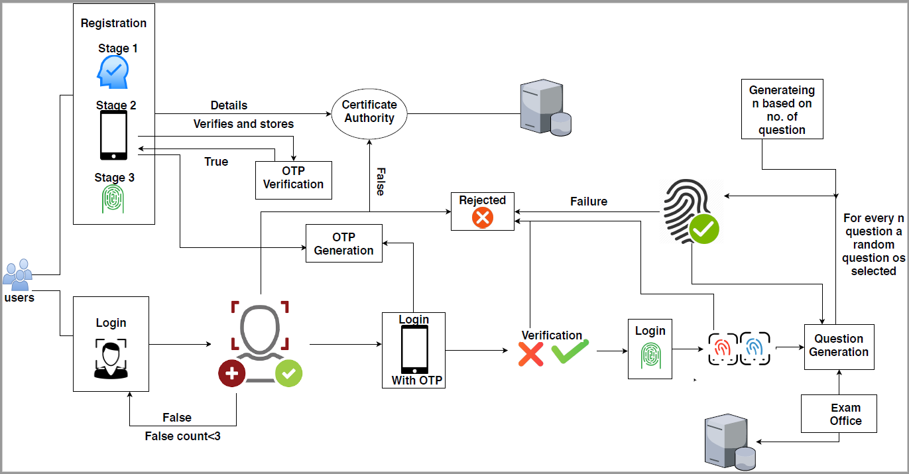

## Abstract

Multi-factor authentication schemes have emerged as alternatives to single-factor authentication schemes with the aim
of improving the security. Factors like passwords, biometrics smart/id cards have been used in combinations in addition to mobile OTPs for enhancing security. Conventional authentication schemes are inadequate for security-critical applications like financial transaction, online examinations,etc. The paper focuses on discussing a multi-factor authentication scheme specifically designed for securing online examination services without comprising user-friendliness. The experimentation results clearly brought out the applicability of the scheme in real time with fine-tuning of network related parameters.

## Features

  * Modules used :
      * Face Recognition modules
      * OTP Module
      * Fingerprint Module
  * Mitigating different forms of attacks.
  * User-friendly

This paper was published in [International Journal of Pure and Applied Mathematics](https://acadpubl.eu/hub/2018-119-15/4/783.pdf)
