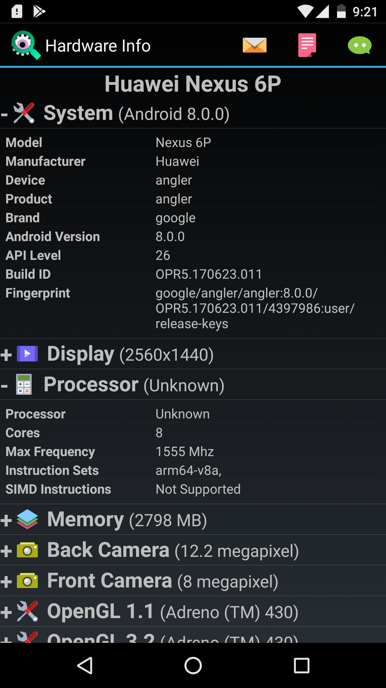
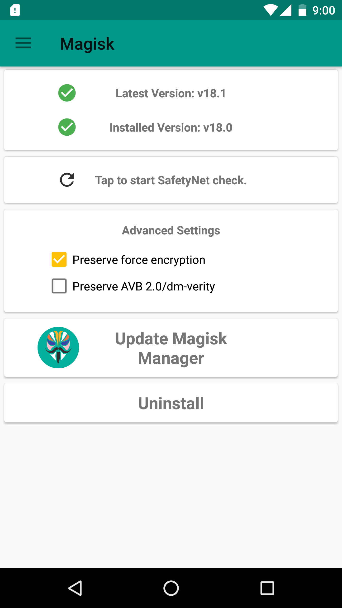
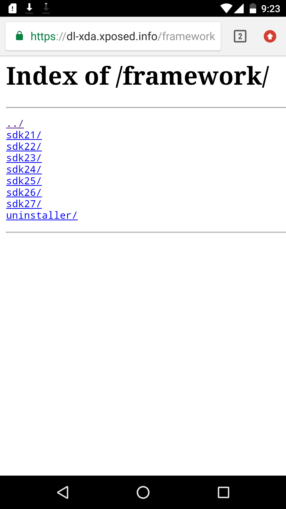
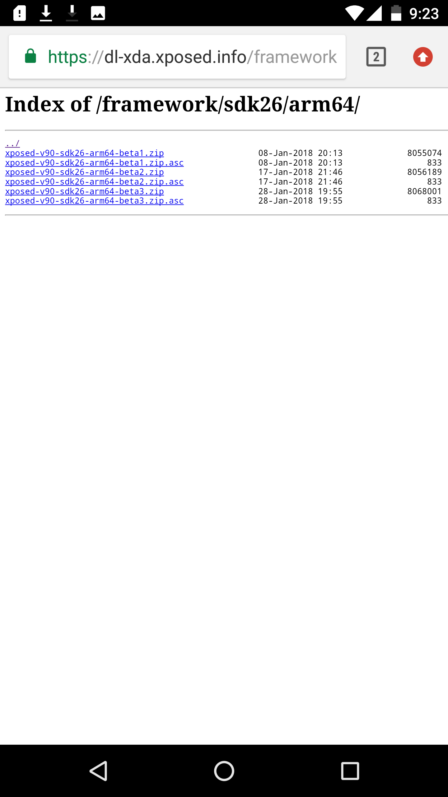
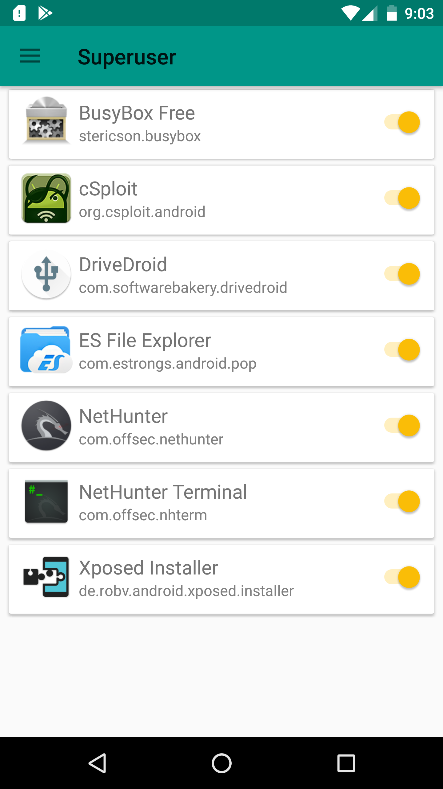
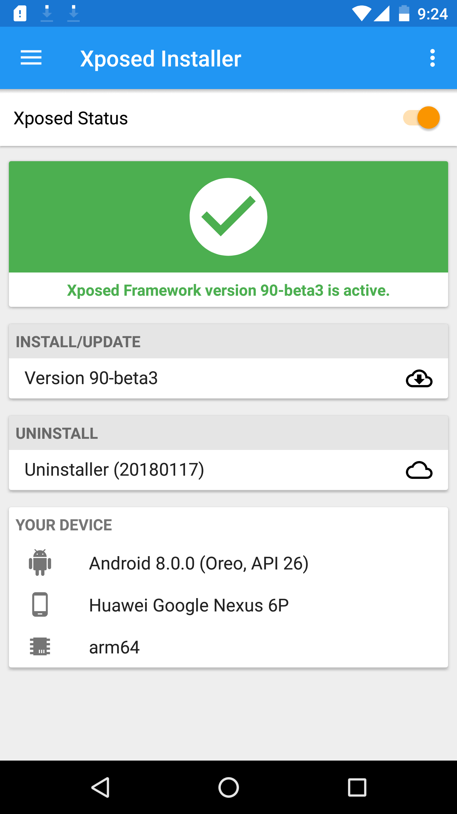
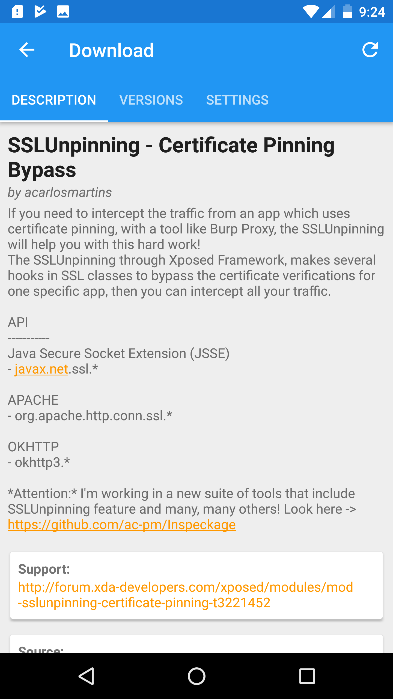
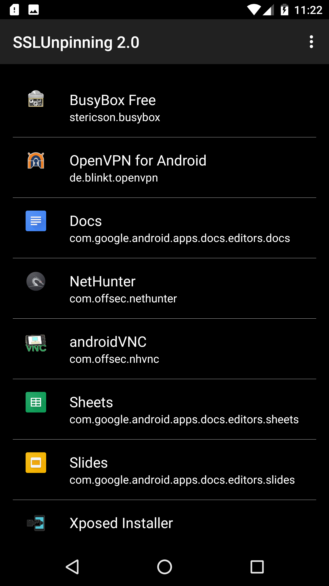
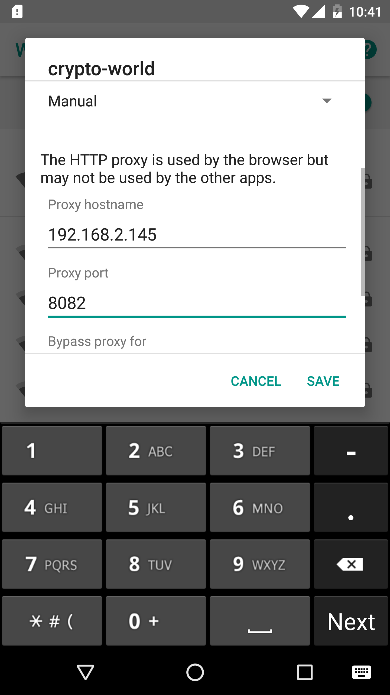

### Why SSL pinning?

SSL Pinning is where you ignore that whole thing, and say trust this certificate only or perhaps trust only certificates which are signed by this CA. 

### Ways to bypass android ssl verification certificate pinning

1. Adding a Custom CA to the User Certificate Store
2. Overwrite Packaged CA Certificate with Custom CA Certificate
3. Frida Hook
4. Reversing Custom Certificate Validation Code


### Method used

Xposed framework is somewhat similar to technique 3 - Frida framework, both the method allows tampering with an application’s code at runtime. The Xposed framework requires root privilege, but Frida gains access to the full suite of Frida functionality without rooting a device. 

In this process, the device used is nexus 6p and Hardware Info about this device which is useful when installing the Xposed framework.



### Root
Android version is oreo 8.0. I used magisk to root the device and can't root the device using SuperSU latest version leads to bootloop for this version of this device.

Choose SuperSu or Magisk based on the usage. SuperSU changes the system files and adds new files to the system partition on the phone and Magisk is called a “systemless” root because it doesn’t touch any of those system files.



### Xposed Framework Installation 
Install the xposed framework based on the device android version(SDK 26) and instruction sets(arm64).





I prefer manual flashing using recovery mode.

Install xposed apk 3.1 and grant a root privilege using magisk.




### SSLUnpinning 2.0 module
Now, SSLUnpinning 2.0 module can be installed from xposed framework.



Soft reboot, To activate the module and list of apps can be seen in SSLUnpinning application. Choose the target application and unpin that.



### Configuring BurpSuite

Now, for MITM configure the burpsuite with the interface as its own IP and the port number as 8082(for ex). Connect the target android phone in the same network and set manual proxy to burpsuite pc's ip and port as below



Now the targeted app, establish the connection and https packets can be captured.


## Reference
```
https://blog.netspi.com/four-ways-bypass-android-ssl-verification-certificate-pinning/
```
