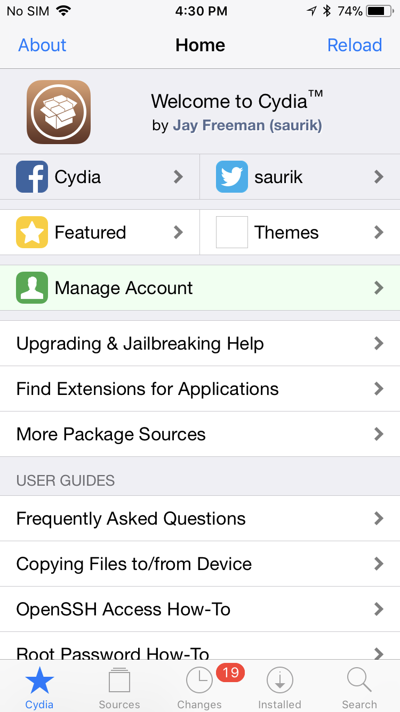
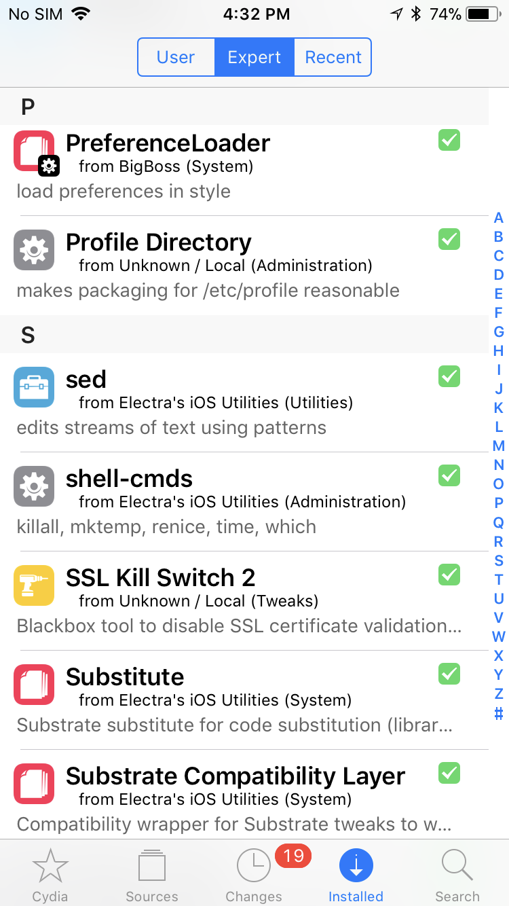
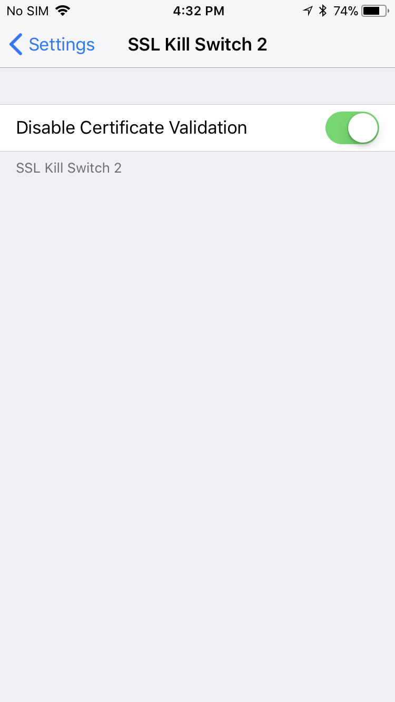

### Why SSL pinning?

SSL Pinning is where you ignore that whole thing, and say trust this certificate only or perhaps trust only certificates which are signed by this CA. 

### Ways to bypass Ios ssl verification certificate pinning

1. Installing your own CA
2. Installing Software to iOS Device
3. Using Objection and Frida
4. Using disassemblers to modify IPA file

## Method used

This method requires jailbroken device and it should be less than ios version 12 for ssl-kill-switch2 to work. To jailbreak the device, Electra is used. 

### Jailbreak

Install Hydra, using Cydia Impactor and click `jailbreak` button. After jailbreak is done, Cydia application will be installed. Make sure SSH connection is proper.



### Dependencies 

Make sure to install following packages.

1. Debian Packager
2. Cydia Substrate
3. PreferenceLoader



### SSL-Kill-Switch2

Transfer the application to iphone using any method and use below commands to make that work.
```
$dpkg -i <package>.deb
$killall -HUP SpringBoard
```
dpkg is used to install the package and another command is to restart that.

Finally, enable ssl-kill-switch2 in settings.



Note: Unpinning happens in the runtime. So, No need to mention specific application. 

## Reference
```
https://github.com/nabla-c0d3/ssl-kill-switch2
```
