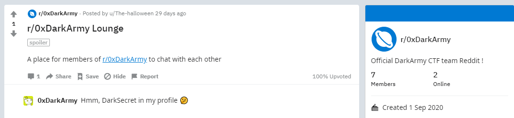
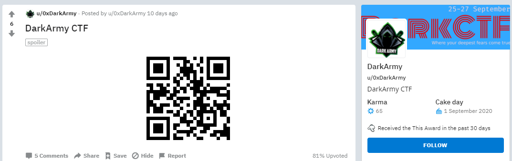
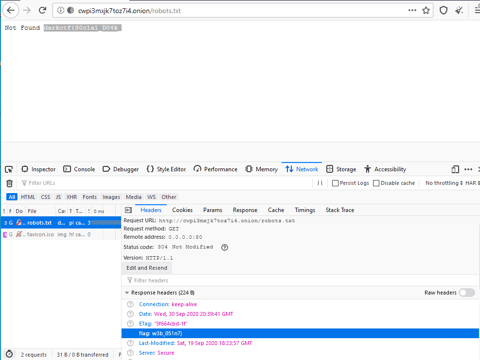

# Dark Social Web
> Points: `472`

> Challenge author: Mukhilan Pari, Whitewolf

## Description
> 0xDarkCTF has 1 social account, and the team uses the same name everywhere. Hint: The front page of internet
>Hint: the front page of the internet
> flag format: darkctf{}


## Solution

The team already had accounts on Twitter and Instagram under the same name for a long time, but never advertised the Reddit community r/0xDarkCTF or the user account u/0xDarkCTF.

Players who didn’t know the Reddit account could find it from the hint: Reddit’s slogan is “The Front page of the internet”.

Alternative: 
https://github.com/sherlock-project/sherlock
```python
python3 sherlock 0xDarkCTF
```  
Sherlock will give you the intended result of social media accounts.


In r/0xDarkCTF, there is a pinned post as below, 



A comment from 0xDarkCTF hints at “DarkSecret” in the profile; one post by u/0xDarkCTF, marked as a spoiler, contains a QR code that leads to an .onion website.



Tor is needed for opening .onion sites, in that 1st part of the flag is in robots.txt and 2nd part of the flag is in the request body as flag header,



## Flag
> darkctf{S0c1a1_D04k_w3b_051n7}
