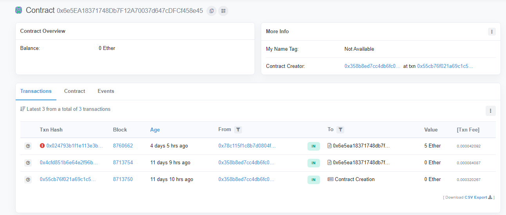
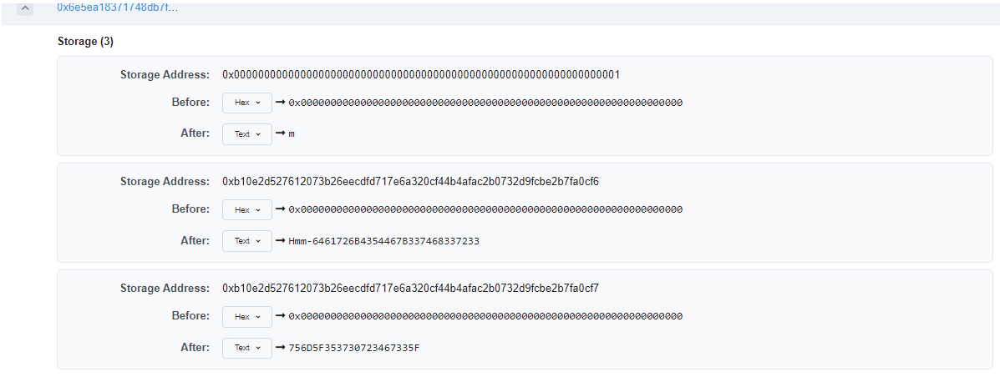
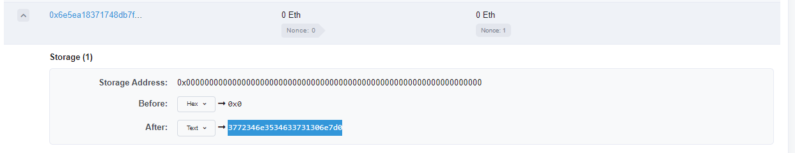

# Secret Of The Contract
> Points: `465`

> Challenge author: Mukhilan Pari, RDxR10

## Description
> Ropsten network contains my dark secret. Help us find it. Name of the contract was 0x6e5EA18371748Db7F12A70037d647cDFCf458e45

## Solution
From the Description, One of the Etherum’s blockchain public network is Ropsten Network.

As its a Ropsten network, [TESTNET Ropsten (ETH) Blockchain Explorer](https://ropsten.etherscan.io/) this website reads the public information from the ethereum. By searching `0x6e5EA18371748Db7F12A70037d647cDFCf458e45` this contract id will give the history of transaction associated with the contract as below.



By checking the state of the 1st transaction will give you the 1st part of the flag.



```python
>>> bytes.fromhex('3772346e3534633731306e7d')
b'7r4n54c710n}'
```

By checking the 2nd part of the transaction(which is the deploy transaction) in the state change will give you the second part.



```python
>>> bytes.fromhex('6461726B4354467B337468337233756D5F353730723467335F')
b'darkCTF{3th3r3um_570r4g3_'
```

Therefore, Combining both will give you the flag.

## Flag
>darkCTF{3th3r3um_570r4g3_7r4n54c710n}
