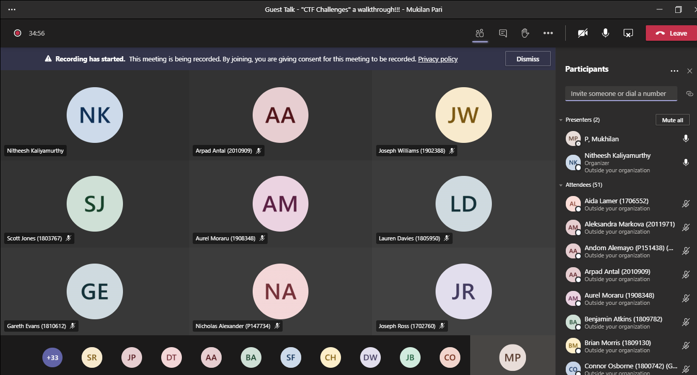

I was given an opportunity to guest lecture at the University of Wales Trinity Saint David on 5th Nov 2020, sharing some ideas with students studying Cyber Security on "CTF(aka Capture the Flag) - Learn, Play & Fun". Mainly the topic is about online cyber activities to increase cyber skills regularly with fun(that's CTF). 



I was so happy with how it turned out and few questions from the students are great, I may have spoken a little quick in sections, but all in all I think it was a success. I even got a compliment from a student after which is a good sign!


### Credit:
Thank you so much **Nitheesh Murugan Kaliyamurthy** (Lecturer at UWTSD) for giving me the opportunity and without your support this wouldn't be possible.
LiveOverFlow - keeps me motivated.
 
### Slide link:
```link
https://drive.google.com/file/d/1BP-PNC5-_1K2Fh-4VMpj3T1pWoFv-mAM/view?usp=sharing
```
